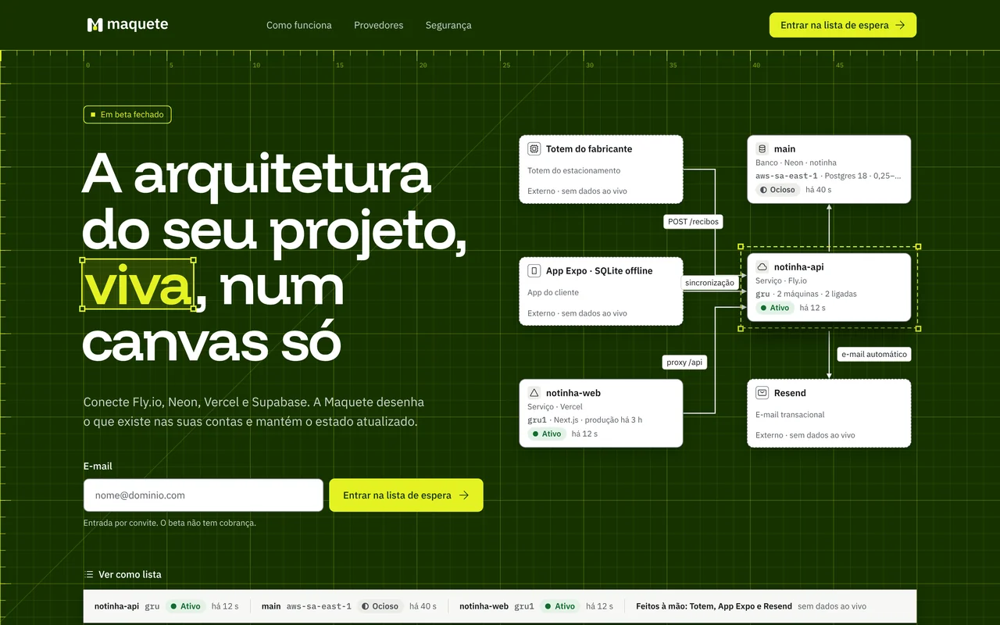
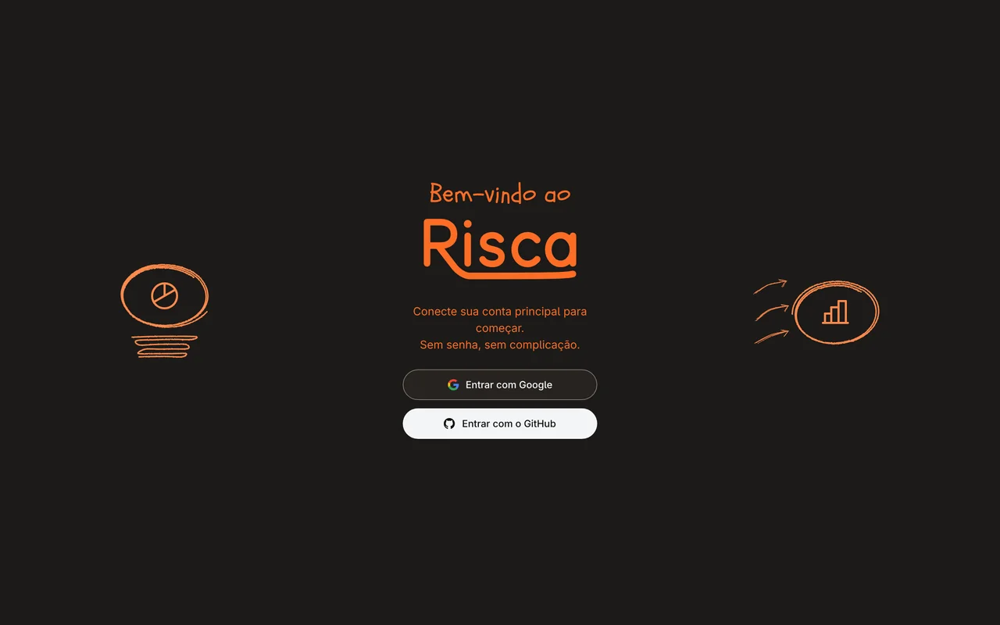
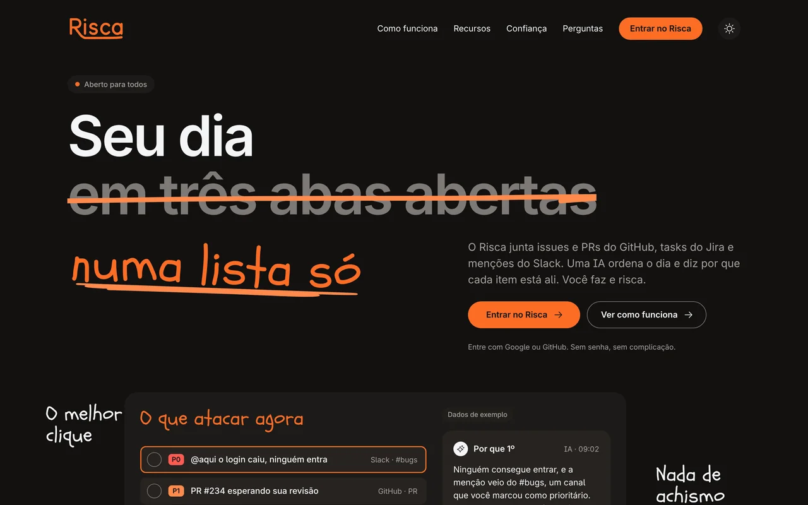
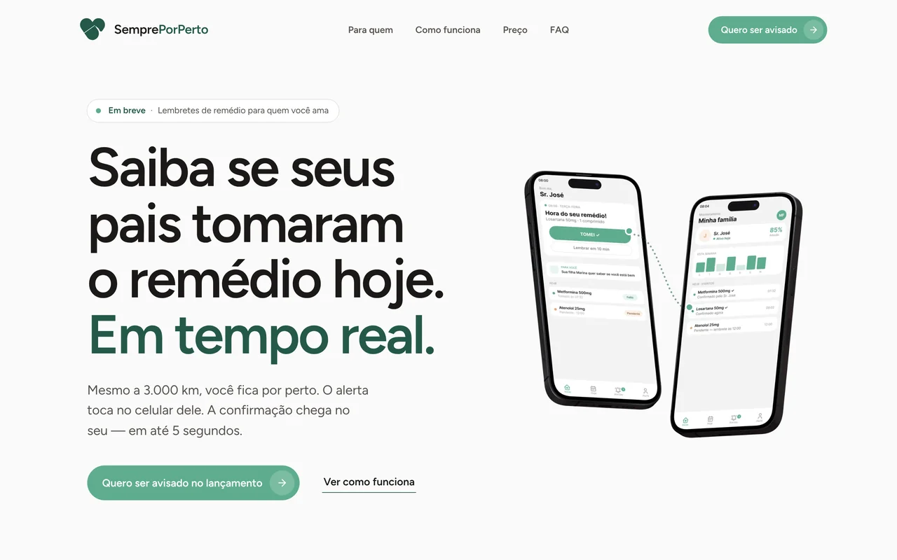
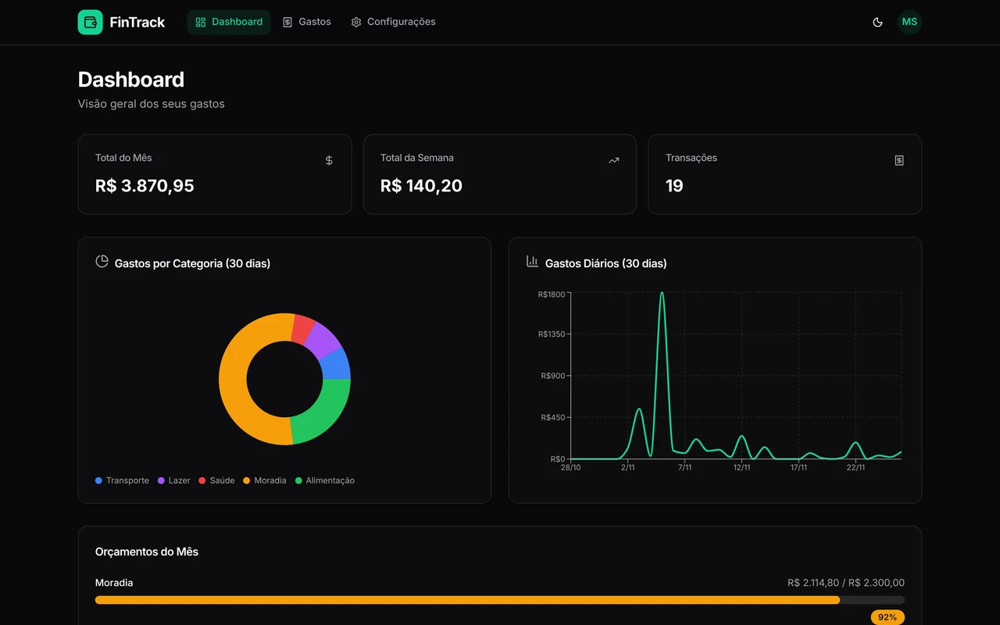
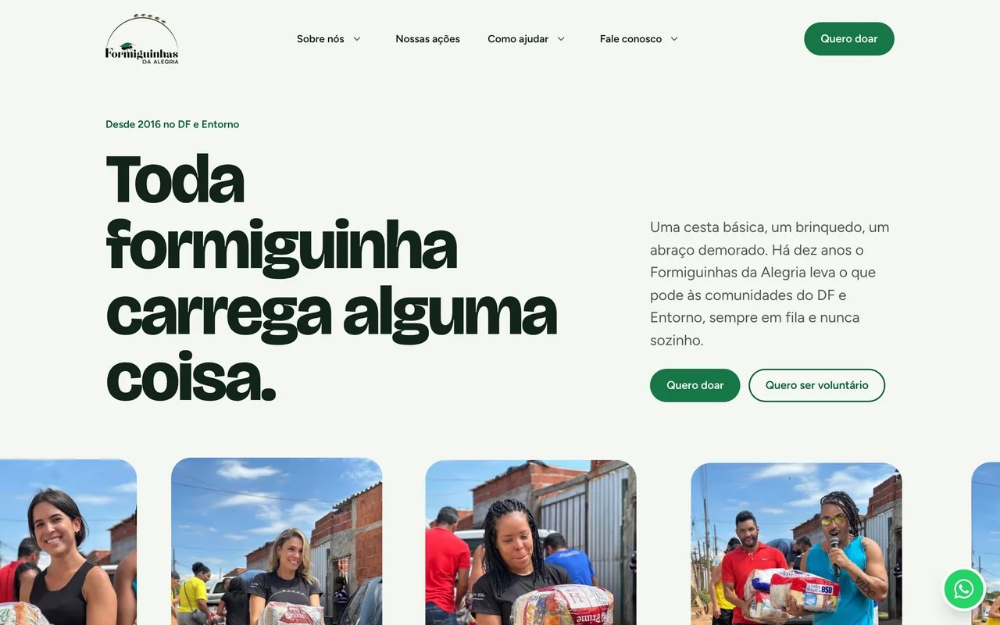
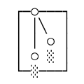
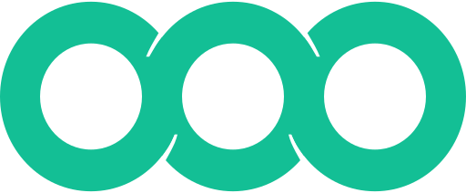
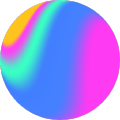

<!-- <h1>⚡Olá, eu sou o João!</h1>

Desenvolvedor Full Stack em Brasília, construindo produtos digitais da interface ao banco de dados. -->

[📖 Sobre](#sobre) • [🚀 Projetos](#projetos) • [💻 Tecnologias](#tecnologias) • [⚙️ Ferramentas](#ferramentas) • [👨‍💻 Contato](#contato)

###

<!-- <h2 align="center" id="sobre">📖 Sobre mim</h2>

- 💼 Desenvolvedor Full Stack freelancer: produtos digitais, integrações com APIs e banco de dados, com foco em SEO técnico e DX de manutenção.
- 🎓 Estudante de Engenharia de Software no Centro Universitário de Brasília (UniCEUB).
- 🛠️ Stack do dia a dia: TypeScript, React, Next.js, Node.js e Bun, com PostgreSQL e Drizzle no back-end.
- 🤖 IA no fluxo de trabalho: integrações com a Claude API e criação de servidores MCP.
- 📍 Brasília, DF · aberto a projetos freelance, remotos ou presenciais. -->

###

  
  
  <!--  -->

<h2 align="center" id="projetos">🚀 Projetos recentes</h2>

<table>
  <tr>
    <td width="50%" valign="top">
      
      <h3>🧩 Maquete — Landing Page</h3>
      Landing page · produto · nov/2026
      
Landing do canvas que desenha a arquitetura de projetos em Fly.io, Neon, Vercel e Supabase. Um sistema de exemplo se monta peça por peça com GSAP, e a página continua legível sem JavaScript.

      
<b>Stack:</b> Next.js · React · TypeScript · Tailwind CSS · GSAP · Zod

      
<a href="https://www.maquete.dev/">🌐 maquete.dev</a>

    </td>
    <td width="50%" valign="top">
      
      <h3>✍️ Risca — App</h3>
      Painel pessoal · produto próprio · nov/2026
      
Junta issues e PRs do GitHub, tasks do Jira e menções do Slack numa lista do dia que a Claude API ordena e explica. Monorepo com API Elysia, worker em Bun com BullMQ e tempo real via Redis + SSE.

      
<b>Stack:</b> Next.js · Elysia · Bun · Drizzle · PostgreSQL · Redis · Claude API

      
<a href="https://app.risca.tech/">🌐 app.risca.tech</a>

    </td>
  </tr>
  <tr>
    <td width="50%" valign="top">
      
      <h3>📝 Risca — Landing Page</h3>
      Landing page · produto · nov/2026
      
Antes de ler qualquer argumento, o visitante risca tarefas numa demo funcional, com desfazer e trava. Movimento em GSAP que respeita quem prefere menos movimento e deploy liberado só com SonarQube, Semgrep e Trivy no verde.

      
<b>Stack:</b> Next.js · React · TypeScript · Tailwind CSS · GSAP · SonarQube

      
<a href="https://www.risca.tech/">🌐 risca.tech</a>

    </td>
    <td width="50%" valign="top">
      
      <h3>💊 SemprePorPerto</h3>
      Landing de pré-lançamento · produto próprio · mai/2026
      
Captação de leads de um app de lembretes de remédio para idosos. Formulário de e-mail e WhatsApp com validação em tempo real, leads em PostgreSQL e envios automáticos por fila.

      
<b>Stack:</b> Next.js · TypeScript · Zod · Drizzle · Supabase · Redis

      
<a href="https://sempreporperto.com.br/">🌐 sempreporperto.com.br</a>

    </td>
  </tr>
  <tr>
    <td width="50%" valign="top">
      
      <h3>💰 FinTrack</h3>
      MVP de finanças pessoais · produto próprio · abr/2026
      
Aplicação multiusuário de finanças pessoais: cadastro de gastos, categorias próprias, orçamento por categoria, metas de economia e painel com gráficos e alertas. <i>Print com dados de exemplo.</i>

      
<b>Stack:</b> Next.js · React · TypeScript · Drizzle · SQLite · Recharts

      
<a href="https://fintrack-omega-snowy.vercel.app/">🌐 Deploy</a> · <a href="https://github.com/joaogabrieldev/projeto-fintrack">💻 Código</a>

    </td>
    <td width="50%" valign="top">
      
      <h3>🐜 Formiguinhas da Alegria</h3>
      Site institucional de ONG · mar/2026
      
Site da ONG que atua desde 2016 no DF e Entorno, feito para divulgar a causa e aproximar doadores e voluntários.

      
<b>Stack:</b> Next.js · TypeScript · Supabase · Drizzle · Stripe

      
<a href="https://www.formiguinhasdaalegria.com.br/">🌐 formiguinhasdaalegria.com.br</a>

    </td>
  </tr>
</table>

###

<h2 align="center" id="tecnologias">💻 Tecnologias 💻</h2>

<!-- Ícones do svgl (https://svgl.app). Os ícones com versão clara e escura usam <picture> para acompanhar o tema do GitHub. -->

<h3>🖼️ Front-End</h3>

  
  
  <picture>
    <source media="(prefers-color-scheme: dark)" srcset="https://svgl.app/library/react_dark.svg" />
    
  </picture>
  
  <!-- 
   -->
  
  
  
  
  <picture>
    <source media="(prefers-color-scheme: dark)" srcset="https://svgl.app/library/tanstack_dark.svg" />
    
  </picture>

<h3>⚙️ Back-End & API</h3>

  
  
  <picture>
    <source media="(prefers-color-scheme: dark)" srcset="https://svgl.app/library/expressjs_dark.svg" />
    
  </picture>
  
  
  
  <picture>
    <source media="(prefers-color-scheme: dark)" srcset="https://svgl.app/library/fastify_dark.svg" />
    
  </picture>
  
  
  <!-- 
   -->

<h3>⚡ Frameworks</h3>

  
  
  <!-- 
  
  <picture>
    <source media="(prefers-color-scheme: dark)" srcset="https://svgl.app/library/astro-icon-dark.svg" />
    
  </picture> -->
  <!--  -->
  
  
  
  
  <picture>
    <source media="(prefers-color-scheme: dark)" srcset="https://cdn.simpleicons.org/expo/white" />
    
  </picture>

<h3>🗄️ Bancos de Dados & ORMs</h3>

  
  
  <picture>
    <source media="(prefers-color-scheme: dark)" srcset="https://svgl.app/library/mysql-icon-dark.svg" />
    
  </picture>
  
  
  
  <picture>
    <source media="(prefers-color-scheme: dark)" srcset="https://svgl.app/library/mongodb-icon-dark.svg" />
    
  </picture>
  
  
  
  <picture>
    <source media="(prefers-color-scheme: dark)" srcset="https://svgl.app/library/prisma_dark.svg" />
    
  </picture>
  
  <picture>
    <source media="(prefers-color-scheme: dark)" srcset="https://svgl.app/library/drizzle-orm_dark.svg" />
    
  </picture>

<h3>🚀 Deploy</h3>

  <picture>
    <source media="(prefers-color-scheme: dark)" srcset="https://svgl.app/library/vercel_dark.svg" />
    
  </picture>
  
  <picture>
    <source media="(prefers-color-scheme: dark)" srcset="https://cdn.simpleicons.org/koyeb/white" />
    
  </picture>
  
  <!-- <picture>
    <source media="(prefers-color-scheme: dark)" srcset="https://svgl.app/library/render_white.svg" />
    
  </picture> -->
  <!--  -->
  
  
  
  
  <picture>
    <source media="(prefers-color-scheme: dark)" srcset="https://svgl.app/library/railway_dark.svg" />
    
  </picture>

<h3>🏛️ Infra</h3>

  
  
  
  
  
  
  
  
  <picture>
    <source media="(prefers-color-scheme: dark)" srcset="https://svgl.app/library/turso-dark.svg" />
    
  </picture>
  
  <picture>
    <source media="(prefers-color-scheme: dark)" srcset="https://svgl.app/library/aws_dark.svg" />
    
  </picture>
  
  
  
  
  

<h3>🔐 DevSecOps</h3>

  
  
  
  
  
  
  

<h3>🧪 Testes & Documentação</h3>

  
  
  
  
  

<h3>🤖 Inteligência Artificial</h3>

  <picture>
    <source media="(prefers-color-scheme: dark)" srcset="https://svgl.app/library/model-context-protocol-dark.svg" />
    
  </picture>
  
  
  
  <picture>
    <source media="(prefers-color-scheme: dark)" srcset="https://svgl.app/library/openai_dark.svg" />
    
  </picture>
  
  
  
  <picture>
    <source media="(prefers-color-scheme: dark)" srcset="https://svgl.app/library/midjourney-dark.svg" />
    
  </picture>
  
  
  
  <picture>
    <source media="(prefers-color-scheme: dark)" srcset="https://svgl.app/library/typesafe-ai-dark.svg" />
    
  </picture>

<h3>🖌️ Design & UI/UX</h3>

  
  
  <picture>
    <source media="(prefers-color-scheme: dark)" srcset="https://svgl.app/library/framer_dark.svg" />
    
  </picture>
  
  
  
  
  
  
  
  

<h3>🧰 Tooling & Build</h3>

  
  
   
  
  <picture>
    <source media="(prefers-color-scheme: dark)" srcset="https://svgl.app/library/pnpm_dark.svg" />
    
  </picture>
  
  <picture>
    <source media="(prefers-color-scheme: dark)" srcset="https://svgl.app/library/turborepo-icon-dark.svg" />
    
  </picture>

<h3>✨ Extras</h3>

  
  
  

<h3>🧩 Usadas nos projetos</h3>

  
  
  
  
  
  
  <picture>
    <source media="(prefers-color-scheme: dark)" srcset="https://svgl.app/library/clerk-icon-dark.svg" />
    
  </picture>
  
  <picture>
    <source media="(prefers-color-scheme: dark)" srcset="https://cdn.simpleicons.org/sentry/white" />
    
  </picture>

###

<h2 align="center" id="ferramentas">⚙️ Ferramentas & IDEs ⚙️</h2>

###

  
  
  <picture>
    <source media="(prefers-color-scheme: dark)" srcset="https://svgl.app/library/cursor_dark.svg" />
    
  </picture>
  
  
  
  <picture>
    <source media="(prefers-color-scheme: dark)" srcset="https://svgl.app/library/github_dark.svg" />
    
  </picture>
  
  
  
  
  
  
  
  
  
  

###

<!-- 

  

 -->

###

  

###

<h2 align="center" id="contato">👨‍💻 Contato</h2>

### João Gabriel R. Rocha

---

Feito com ❤️, TypeScript e muito café.

